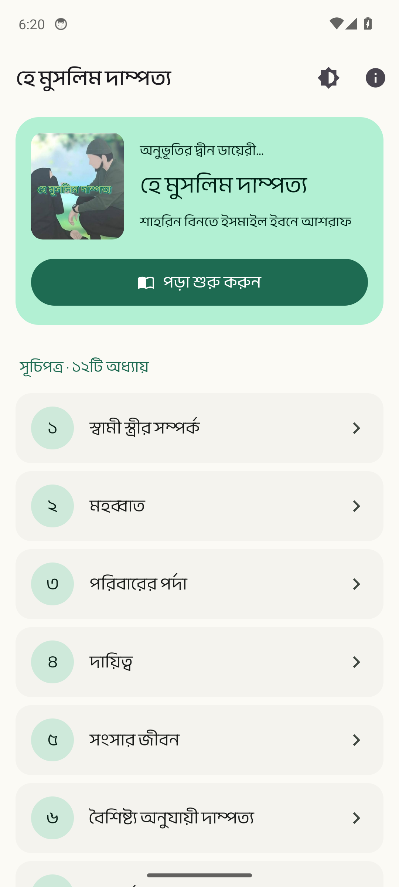
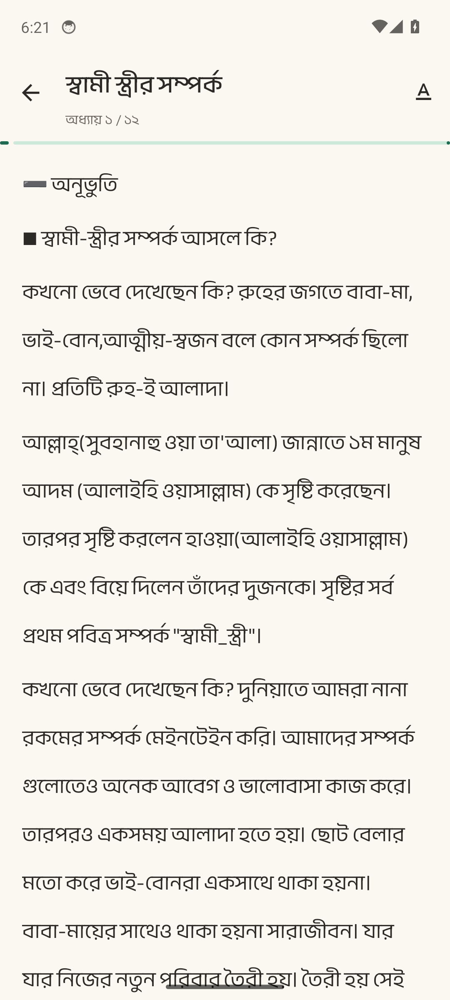
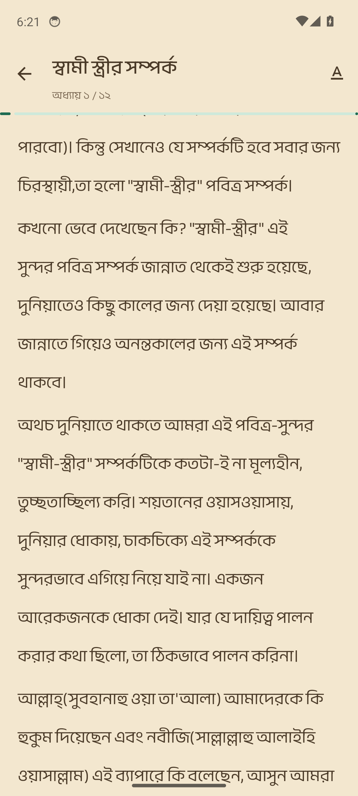
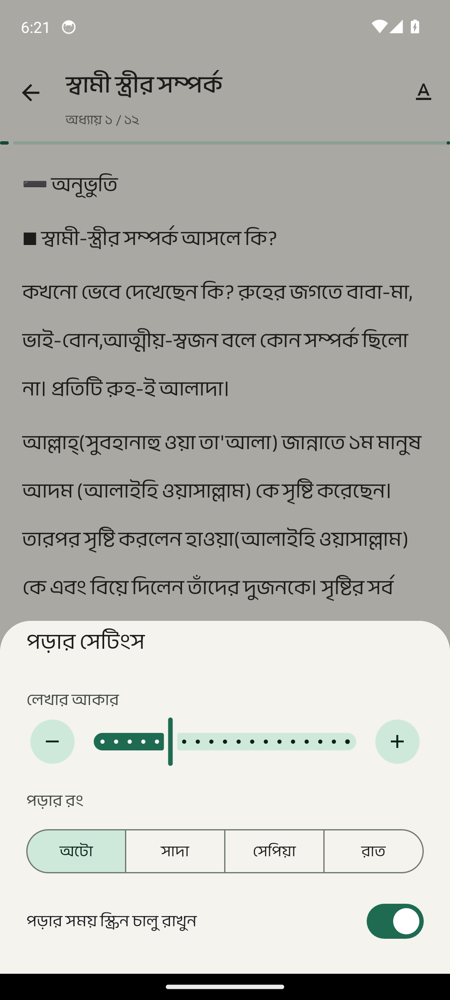
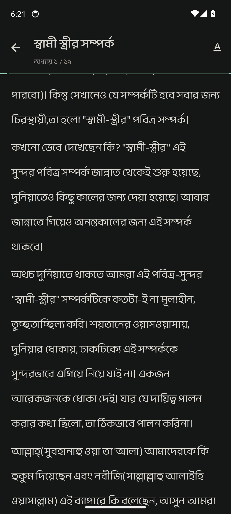

<div align="center">

# হে মুসলিম দাম্পত্য

**অনুভূতির দ্বীন ডায়েরী — লেখিকা শাহরিন ছিদ্দিকা**

A Bengali Islamic book about married life, turned into a quiet, distraction-free Android ebook.
It works completely offline, with no ads and no account.

[](../../releases/latest)
[](../../actions/workflows/ci.yml)
[](#install)
[](#how-its-built)

[**Download the APK**](../../releases/latest) · [Report a problem](../../issues/new)

<br />


&nbsp;

&nbsp;


</div>

---

## বইটি সম্পর্কে · About the book

**হে মুসলিম দাম্পত্য** is a book by **শাহরিন ছিদ্দিকা** about the relationship between husband and wife,
written as a diary of feelings, as the subtitle *অনুভূতির দ্বীন ডায়েরী* says. It has **১২টি অধ্যায় (12 chapters)**,
plus the author's own note on the book, লেখকের কথা.

Long Bangla text is tiring to read on a small screen, so the whole app is built around one thing: making
the reading comfortable. Generous line spacing, a warm page colour, and nothing on screen except the words.

## Features

- **Read offline.** The whole book ships inside the app. It doesn't even ask for internet permission.
- **Pick up exactly where you stopped.** The app reopens the chapter at the same spot, and the home screen offers to continue.
- **Your reading, your way.** Change the text size, and choose an automatic, paper, sepia or night page.
- **Progress as you read.** A thin bar under the chapter title shows how far through the chapter you are.
- **Copy a line you love.** Long-press any paragraph to copy it and share it.
- **Bangla throughout:** chapter numbers and progress in Bangla numerals.
- **About the writer:** a short introduction to the author, and her own words on the book.

## Screenshots

| Home | Chapter | Reader settings | Sepia page | Night page |
|:---:|:---:|:---:|:---:|:---:|
|  |  |  |  |  |

## Install

1. Open the [latest release](../../releases/latest) on your Android phone.
2. Download `app-release-signed.apk` and open it.
3. If Android asks, allow installs from your browser or file manager.

Works on Android 7.0 (API 24) and newer.

## How it's built

| | |
|---|---|
| **Language** | Java |
| **UI** | Material 3 (Material Components 1.14), RecyclerView-based reader, bottom-sheet reader settings |
| **Book content** | Plain-text chapters in `app/src/main/assets/`, split into paragraphs at runtime |
| **Storage** | SharedPreferences for the last position, text size and page theme |
| **Android** | min SDK 24, target SDK 36 |
| **CI / releases** | GitHub Actions runs lint and unit tests on every pull request; each push to `main` builds a signed APK and AAB and publishes a GitHub Release. An instrumented test captures the screenshots above. |

```text
app/src/main/
├── assets/                     the book, one text file per chapter
└── java/com/shahrinsiddeka/heamoslimdampatya/
    ├── MainActivity            home: book card, continue reading, chapter list
    ├── ReadChapter             the reader
    ├── ReaderSettingsSheet     text size and page theme
    ├── Book, ReadingPrefs      chapter list and saved reading state
    └── Bangla, ReaderColors    Bangla numerals and page themes
```

## Build from source

You'll need Android Studio (latest stable) and JDK 21.

```bash
git clone https://github.com/toufikforyou/hea-muslim-dampatya-book-app.git
cd hea-muslim-dampatya-book-app

./gradlew assembleDebug        # build a debug APK
./gradlew testDebugUnitTest    # run the unit tests
```

## Credits

- **Book:** শাহরিন ছিদ্দিকা (Shahrin Siddeka). The book's text belongs to the author.
- **App:** designed and built by **MH TOUFIK** · [@toufikforyou](https://github.com/toufikforyou) · [toufikforyou.dev](https://www.toufikforyou.dev)
